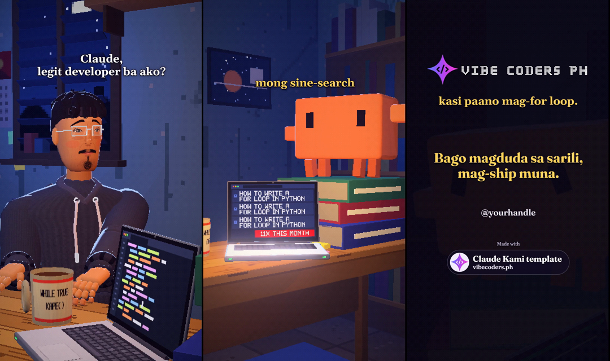

# Claude Kami Template

**Taglish:** Gumawa ng sarili mong skit video na code ang gumuguhit ng bawat frame, sa pakikipag-usap lang kay Claude Code. Wala kang isusulat na code.

**English:** Make your own skit videos where code draws every frame, just by talking to Claude Code. You write no code.

Basahin sa: [Taglish](#taglish) | [English](#english)

---

# Taglish

## Ano ito

Ito ang engine sa likod ng **Claude Kami**, ang skit series ng [Vibe Coders PH](https://vibecoders.ph). Si Buloy (low-poly na Pilipinong developer) ay nakikipag-usap kay Claude (isang orange na block, deadpan at honest) sa Taglish, sa iba't ibang lugar sa Pilipinas tulad ng sari-sari store o jeepney.

Walang AI-generated na video dito. Code ang bawat frame: Three.js ang gumuguhit ng eksena, HyperFrames ang nagre-render ng video.

Template ito. I-clone mo, tapos gagawa ka ng sarili mong episodes gamit ang sarili mong idea.

## Ang kwento

Vibe coders tayo, kaya si Claude ang gagawa. May code, oo, at nandito lahat, pero hindi mo kailangang mag-code ng kahit ano: nasa skills na 'yon. Clone mo lang.

Hindi lahat ng nasa community natin ay technical, pero gusto nilang gumawa ng video. Kaya walang step-by-step tutorial na puro code. Ano pa ang point? May Claude naman tayo, kaya si Claude ang gagamitin. Siya lang ang kailangan mong bayaran para makapag-render ng example (tingnan sa ibaba kung kailan may iba pang gastos).

Libre ang ibinabahagi namin, walang gatekeeping. Pero template ito: ilalagay mo ang sarili mong taste at assets. Ikaw pa rin ang bahala sa creative work mo.

## Ano ang kailangan at magkano

**Kailangan:**

- Computer: Windows, macOS o Linux. Sa Windows 11 pa lang ito na-test, kaya 'yon pa lang ang sigurado namin.
- Claude Code, sa paid na Claude plan.
- git, Python 3.10 pataas (may Pillow at numpy), Node.js 22 pataas, at ffmpeg. Kung wala ka pa nito, si Claude na ang mag-i-install, basta pumayag ka.
- Internet sa unang render: dina-download nito ang sarili nitong headless Chrome at naglo-load ng dalawang library mula sa web. Ang tatlong file ng isang tapos na cut ay mga 150 MB.

**Magkano, walang paligoy:**

- **Claude (ito ang pinakamalaking gastos).** Nasa lahat ng paid plan ang Claude Code, wala sa free. Pro: $20 kada buwan (o $17 kada buwan kung yearly ang bayad). Max: simula $100 kada buwan. [claude.com/pricing](https://claude.com/pricing)
- **ElevenLabs (mga boses).** Ang Free plan ay $0 na may 10,000 credits kada buwan. Mga 1 credit ang bawat character ng speech, at mga 800 hanggang 1,000 characters ang isang episode. Hanggang mga sampung episodes kada buwan, kung walang ni-re-voice at hindi ka gagawa ng sound effects (mas marami ang credits na kinakain ng mga iyon kaysa sa isang spoken line). **Pero walang commercial licence ang Free plan: personal, non-commercial use lang.** Sa Free din, hindi magagamit ng API ang Voice Library voices. Ang Starter ay $6 kada buwan: may commercial licence, 30,000 credits, at library voices. [elevenlabs.io/pricing](https://elevenlabs.io/pricing) at [Voice Library docs](https://elevenlabs.io/docs/product-guides/voices/voice-library)
- **Gemini API (optional).** Ang check na nakikinig sa tapos nang video para i-check kung malinaw ang bawat salita ay optional. Magtatanong muna si Claude, kasi ipapadala nito ang audio sa Google. Sa free tier, puwedeng gamitin ng Google ang ipinapadala mo para pagandahin ang products nila, at puwede ring may taong magbasa nito, kaya huwag kang magpadala ng private. Hindi kailangan ang image generation (bayad lang iyon). [ai.google.dev/gemini-api/docs/pricing](https://ai.google.dev/gemini-api/docs/pricing)
- **HyperFrames** (nagre-render ng video, Apache-2.0) at **Three.js** (MIT): libre, at tumatakbo sa sarili mong computer.

**Tungkol sa mga boses.** Ang example ay ni-voice gamit ang mga default voice ng ElevenLabs na nire-retire na; hindi nito naaapektuhan ang pag-render ng example. Para sa sarili mong episodes, tutulungan ka ng setup na pumili ng dalawang boses na magagamit ng sarili mong ElevenLabs account sa pamamagitan ng API. Sa Free, ito ay boses na dinisenyo mo gamit ang Voice Design, o ang mga lumang default voice kung mas luma ang account mo. Kailangan ng paid plan para sa library voices. Magte-test muna ito ng isang maikling linya ng bawat isa (ilang dosenang credits).

**Tungkol sa effort.** Matagal gumawa ng bagong episode. Ang pinakamahabang hakbang ay ang staging, kung saan isinusulat ni Claude kung paano gumagalaw ang mga karakter sa bawat linya, at malaking bahagi ito ng limits ng Claude plan mo.

## Paano magsimula

1. Sa GitHub, pindutin ang **Use this template** (o `git clone`).
2. Buksan ang folder sa Claude Code: sa desktop app, o magpatakbo ng `claude` sa terminal sa loob ng folder.
3. Sabihin: **"i-setup mo ako"** (o "set me up"). Ang `kami-setup` skill ang titingin kung ano ang kulang, mag-i-install kapag pumayag ka, gagawa ng `.env`, sasagutan ang `series.json` kasama ka, at magre-render ng example.
4. Panoorin ang example: `renders/00-legit-developer-v1-upload.mp4`.
5. Sabihin: **"gawa tayo ng bagong episode tungkol sa ..."** (o "let's make a new episode about ..."). Itatanong ni Claude ang idea mo, tapos magdi-draft siya ng mga linya para basahin at baguhin mo. Magtatanong din siya bago gumastos ng credits.

Ang `claude-kami` skill ang gumagabay sa buong proseso: idea, script, boses, set at camera, tunog, checks, render.

## Ano ang sa iyo pa rin

Si Claude ang bahala sa files at commands. Sa iyo ang:

- ang idea at ang kwento
- ang final say sa bawat linya (nagdi-draft si Claude, ikaw ang nagde-decide)
- ang mga boses mo
- ang taste mo sa itsura at sa tunog
- ang sarili mong assets (sounds, music, logo) na may karapatan kang gamitin
- ang panonood sa bawat cut bago i-post
- ang pag-post mismo: ikaw ang magpo-post, hindi si Claude

## Ano ang laman

- `src/`, `tools/`, `video/`: ang engine (ang eksena, ang mga command, ang HyperFrames project)
- `docs/`: cinematography, story formula, mga rules ng series, at licences
- `audio-lib/`: maliit na sound kit na gawa sa code (CC0)
- `episodes/00-legit-developer`: ang example episode (Claude Kami episode 13, "Legit Developer", mga 54 segundo). Voiced na ito, kaya nagre-render nang walang kahit anong key
- `series.json`: ang card handle mo, credit, logo, at ang mga boses na pipiliin mo
- `.env.example`: kopyahin bilang `.env` para sa mga keys mo
- `.claude/skills/kami-setup`: unang takbo (checks, install, `.env`, `series.json`, render ng example)
- `.claude/skills/claude-kami`: idea, script, boses, set at camera, tunog, checks, render

## Lisensya, credits at disclaimer

- Code: MIT, tingnan ang [LICENSE](LICENSE).
- Ang mga tunog sa `audio-lib/` ay gawa sa code at inilabas bilang CC0.
- Mga font: Fraunces at Gelasio, sa ilalim ng SIL Open Font License.
- Ang Vibe Coders PH logo ay pag-aari ng Vibe Coders PH. Ang logo sa card ay itinatakda sa `series.json`, kaya ilagay mo ang sarili mo.
- Ang Vibe Coders PH star sa hoodie ng developer ay bahagi ng karakter. Pakiusapan mo si Claude na baguhin kung gusto mo.
- Mga detalye: `docs/licences.md`.

**Disclaimer:** Ang Claude character ay fan-made na paglalarawan. Ang "Claude" ay trademark ng Anthropic. Hindi ito affiliated sa Anthropic at hindi rin ineendorso ng Anthropic.

---

# English

*A full translation of the Taglish section above, in the same order.*

## What this is

This is the engine behind **Claude Kami**, the skit series of [Vibe Coders PH](https://vibecoders.ph). Buloy (a low-poly Filipino developer) talks to Claude (an orange block, deadpan and honest) in Taglish, in different places in the Philippines such as a sari-sari store or a jeepney.

There is no AI-generated video here. Every frame is code: Three.js draws the scene, HyperFrames renders the video.

It is a template. Clone it, then make your own episodes from your own ideas.

## The story

We are vibe coders, so Claude does the work. There is code, yes, and all of it is here, but you do not have to code anything: it is already in the skills. You just clone it.

Not everyone in our community is technical, but they want to make videos. So there is no step-by-step tutorial full of code. What would be the point? We have Claude, so we use Claude. He is the only one you have to pay to render the example (see below for when other costs come in).

What we share is free, no gatekeeping. But this is a template: you add your own taste and your own assets. The creative work is still yours.

## What you need and what it costs

**You need:**

- A computer: Windows, macOS or Linux. So far it has been tested on Windows 11 only, so that is the only one we are sure about.
- Claude Code, on a paid Claude plan.
- git, Python 3.10 or newer (with Pillow and numpy), Node.js 22 or newer, and ffmpeg. If you do not have these yet, Claude installs them, with your OK.
- Internet on the first render: it downloads its own headless Chrome and loads two libraries from the web. The three files of one finished cut take about 150 MB.

**What it costs, plainly:**

- **Claude (the main cost).** Claude Code is in every paid plan, not the free one. Pro is $20 a month (or $17 a month billed yearly). Max starts at $100 a month. [claude.com/pricing](https://claude.com/pricing)
- **ElevenLabs (voices).** The Free plan is $0 with 10,000 credits a month. Speech costs about 1 credit per character, and an episode is about 800 to 1,000 characters. That is up to about ten episodes a month, if nothing is re-voiced and you do not generate sound effects (those cost far more credits than a spoken line). **But the Free plan has no commercial licence: personal, non-commercial use only.** On Free, the API also cannot use Voice Library voices. Starter is $6 a month: a commercial licence, 30,000 credits and library voices. [elevenlabs.io/pricing](https://elevenlabs.io/pricing) and the [Voice Library docs](https://elevenlabs.io/docs/product-guides/voices/voice-library)
- **Gemini API (optional).** The check that listens to the finished video to see that every word comes through is optional. Claude asks you first, because it sends the audio to Google. On the free tier, Google may use what you send to improve its products, and people may review it, so send nothing private. Image generation is paid only and not needed. [ai.google.dev/gemini-api/docs/pricing](https://ai.google.dev/gemini-api/docs/pricing)
- **HyperFrames** (renders the video, Apache-2.0) and **Three.js** (MIT): free, and they run on your own computer.

**About the voices.** The example was voiced with ElevenLabs default voices that are being retired; that does not affect rendering it. For your own episodes, the setup helps you pick two voices your own ElevenLabs account can use through the API. On Free, that is a voice you design with Voice Design, or the old default voices if your account is older. Library voices need a paid plan. It tests one short line of each first (a few dozen credits).

**About the effort.** A new episode takes a while. The longest step is staging, where Claude writes how the characters move on every line, and it uses a good share of your Claude plan's limits.

## How to start

1. On GitHub, press **Use this template** (or `git clone`).
2. Open the folder in Claude Code: in the desktop app, or run `claude` in a terminal inside the folder.
3. Say: **"set me up"** (or "i-setup mo ako"). The `kami-setup` skill checks what is missing, installs it when you say yes, makes your `.env`, fills in `series.json` with you, and renders the example.
4. Watch the example: `renders/00-legit-developer-v1-upload.mp4`.
5. Say: **"let's make a new episode about ..."** (or "gawa tayo ng bagong episode tungkol sa ..."). Claude asks for your idea, then drafts the lines for you to read and change. It also asks before anything spends credits.

The `claude-kami` skill guides the whole process: idea, script, voices, set and camera, sound, checks, render.

## What is still yours

Claude does the files and the commands. These are yours:

- the idea and the story
- the final say on every line (Claude drafts, you decide)
- your voices
- your taste in the look and the sound
- your own assets (sounds, music, a logo) that you have the right to use
- watching every cut before you post
- posting it yourself: you post, not Claude

## What is inside

- `src/`, `tools/`, `video/`: the engine (the scene, the commands, the HyperFrames project)
- `docs/`: cinematography, the story formula, the series rules, and licences
- `audio-lib/`: a small sound kit made from code (CC0)
- `episodes/00-legit-developer`: the example episode (Claude Kami episode 13, "Legit Developer", about 54 seconds). It is already voiced, so it renders with no keys at all
- `series.json`: your card handle, credit, logo, and the voices you pick
- `.env.example`: copy it to `.env` for your keys
- `.claude/skills/kami-setup`: first run (checks, install, `.env`, `series.json`, render the example)
- `.claude/skills/claude-kami`: idea, script, voices, set and camera, sound, checks, render

## Licences, credits and disclaimer

- Code: MIT, see [LICENSE](LICENSE).
- The sounds in `audio-lib/` are made from code and released as CC0.
- Fonts: Fraunces and Gelasio, under the SIL Open Font License.
- The Vibe Coders PH logo belongs to Vibe Coders PH. The logo on the card is set in `series.json`, so put your own there.
- The Vibe Coders PH star on the developer's hoodie is part of the character. Ask Claude to change it if you want.
- Details: `docs/licences.md`.

**Disclaimer:** The Claude character is a fan-made depiction. "Claude" is a trademark of Anthropic. This project is not affiliated with or endorsed by Anthropic.
